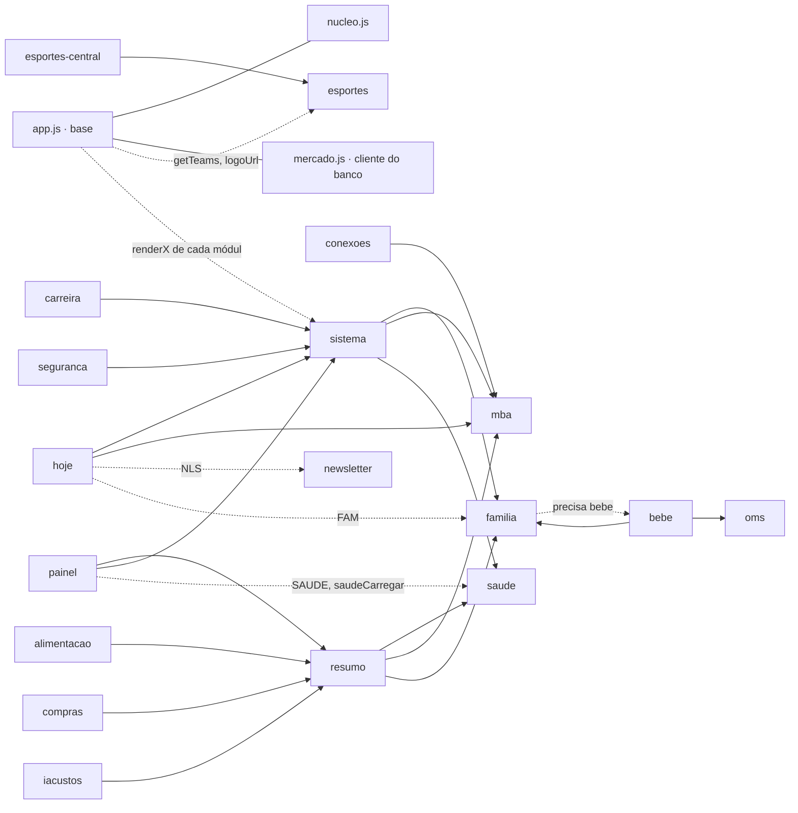

# RAC · 02 · Auditoria arquitetural

Auditoria feita em **13/11/2026** sobre a `main` em `256edfa` (site `2026-11-12.9`), lendo o código, os testes, as migrations, as
Edge Functions, os workflows, o histórico completo (358 commits) e o GitHub (PRs #1 a #5, todos mesclados). O banco de produção foi
consultado só por leitura e sem login (`tests/banco.test.mjs`: 96 objetos conferidos, nenhum dado lido).
Convenções [Fato] / [Hipótese] / [Recomendação]: ver o [Documento 1](01-visao-e-mapa-mestre.md#como-ler-este-conjunto).

## 1. Diagnóstico em uma página

**O RAC é bem construído onde mais importa (segurança, regras de negócio testadas, banco) e está ficando caro de evoluir onde
as telas se encontram (núcleo do site, agregadores e acesso ao banco pelo navegador).**

Pontos fortes [Fato]:

- **Segurança séria**: todas as 46 tabelas com RLS, `revoke ... from anon`, trava de verificação em duas etapas (022), cofres
  privados, passkey, nenhuma chave secreta no site; a IA tem uma porta só (`rac-ia`), orçamento com reserva e nunca grava.
- **Regras puras e testadas**: `nucleo.js` concentra 463 funções sem tela e sem banco; a regra financeira única (`coResumo`,
  `coValorDespesa`) é reaproveitada pelo Painel e pelo RAC Hoje.
- **Cultura de teste incomum para um projeto pessoal**: 69 arquivos e cerca de 1.300 casos, com DOM falso, Postgres de verdade
  em memória (PGlite, Grupo 2 do CI), conferência do banco real só de leitura e teste de navegador no CI.
- **Banco transacional**: gravações importantes por RPC atômica (`pedido_salvar`, `compras_gravar`, `nota_fiscal_salvar`,
  `radar_reservar_consulta`), gatilhos de imutabilidade, migrations idempotentes e numeradas.
- **Base de PWA madura**: carregamento sob demanda de módulos, service worker com estratégias por tipo de arquivo, fila sem
  internet, botão ↻ com "busca antes, troca depois" e proteção de formulário não salvo.

Pontos fracos [Fato, com evidência na seção 6]:

- `js/app.js` e `mercado.js` acumulam responsabilidades de plataforma (login, cliente do banco, rotas, Início, Gmail, IA,
  captura, estudos); o cliente do Supabase mora dentro do módulo Mercado.
- Agregadores (RAC Hoje, Agenda, Painel, Sistema) leem tabelas diretamente e usam variáveis internas de outros módulos.
- Não há camada de acesso a dados no site: 196 chamadas `.from()`/`.rpc()` espalhadas em 18 arquivos.
- Componentes visuais compartilhados moram dentro de módulos funcionais (gráficos do Resumo usados por Painel, Compras, Alimentação e Custos de IA).
- Algumas regras de negócio ainda estão nas telas (`saudeInsights`, `famMeds`) ou duplicadas entre site e servidor (avisos da Agenda).
- A documentação de estado (o que está aplicado ou publicado) diverge em vários pontos.

**Veredito**: não há motivo técnico para reescrever nem trocar de tecnologia. O caminho é **extrair três ou quatro peças de
plataforma** (cliente de dados, kit de UI, registro de rotas e contrato de fontes), em passos pequenos e testados, **antes** de
abrir as frentes novas (Família e Casa, inteligência proativa), que multiplicariam o acoplamento atual.

## 2. Como o site é montado (front-end)

| Aspecto | Como funciona hoje [Fato] | Evidência |
|---|---|---|
| Carga inicial | `index.html` (CSS e todas as `<section>`), depois `nucleo.js`, `mercado.js` e `js/app.js`, sempre, em toda página | `index.html` linhas 1376–1378 |
| Módulos | Cada seção grande é um arquivo em `js/`, carregado quando a rota abre; dependências declaradas em `MOD_DEPS` | `modulo()`, `precisa()`, `ROTA_MODS`, `MOD_DEPS` em `js/app.js` |
| Escopo | Tudo é global (sem `import`); um teste proíbe nome repetido entre arquivos | `tests/estrutura.test.mjs` |
| Rotas | Hash (`#secao/sub/...`); `route()` esconde e mostra as `<section>` e chama a função `renderX` de cada módulo por nome | `route()` em `js/app.js` (≈ 30 ramos `if`) |
| Papéis | `PAPEL` = `dono` ou `casa` (tabela `membros`); a casa só abre as rotas de `DA_CASA` | `entrar()`, `DA_CASA` em `js/app.js` |
| Estado | Variáveis globais por módulo (`SAUDE`, `NLS`, `FAM`, `BEBE`, `RT`…) e `PESSOAL` (um JSON por chave na tabela `pessoal`, 37 chaves em uso) | `pessoalCarregar`, `pessoalGravar` em `js/app.js` |
| Dados | Cada módulo chama o Supabase direto (`SB.from(...)`); o cliente é criado em `mercado.js` (`client()`) e exposto em `window.RACmercado` | `mercado.js` linhas 6–8 e `client()` |
| Sem internet | Fila de gravações em `localStorage` (`rac-fila`), reenviada quando a rede volta | `bancoOuFila`, `processarFila` em `js/app.js` |
| Atualizar (↻) | `atuAtualizar()`: confere o banco (`ping`), espera formulário sujo e tarefas longas, nunca chama Garmin/Gmail/IA; módulos com dados em memória usam `atuModulo` | bloco "Botão de atualizar" em `js/app.js`; `NUCLEO.atu*` |
| PWA | `sw.js`: rede primeiro para o site, cópia guardada e atualização por trás para os `.json`, bibliotecas de CDN guardadas, push e clique na notificação | `sw.js` |
| Visual | ≈ 1.130 linhas de CSS dentro do `index.html`, com tokens de cor dos Dodgers; tema claro por padrão; foto de fundo com cartões translúcidos | `index.html` linhas 23–1156; [Documento 03](03-design-system.md) |

[Fato] A carga inicial soma ≈ 933 KB sem compressão (≈ 279 KB com gzip), metade disso em `nucleo.js` (408 KB), que traz as
regras de **todos** os domínios mesmo para quem só abre a Lista.

## 3. Backend e banco de dados

| Aspecto | Estado [Fato] | Evidência |
|---|---|---|
| Tabelas | 46, por domínio: Mercado (`mercados`, `produtos`, `notas`, `itens`, `orcamentos`), casa (`membros`, `pessoal`, `lista`), família (`registros`, `bebe`), Garmin (`garmin_dia`, `garmin_ativ`), sistema (`erros`, `rotina_log`, `push_inscricoes`, `rac_segredos`, `seguranca_eventos`), IA (`ia_config`, `ia_precos`, `ia_uso`, `ia_cobranca`), Newsletter (2), Alimentação (2), Compras online (6), Fiscal (6), Radar (9) | `schema.sql`, `supabase/0*.sql` |
| Views | `compras` (lida por 8 arquivos do site), `alimentacao_gastos`, `compras_creditos`, `compras_creditos_historico`, `ia_custos`, `radar_precos_final` | `046`, `024`, `031`, `029`, `043` |
| RLS | Ligado em todas; padrão "dono" (`user_id = auth.uid()`) e padrão "casa" (`user_id = dono_da_casa()`, para o que a Fernanda vê) | `002_casa_compartilhada.sql` |
| 2ª etapa | Política restritiva "mfa" em todas as tabelas pessoais (`rac_aal_ok`) | `022`, `033` |
| Funções | 64 funções SQL distintas: orçamento da IA (`ia_reservar`, `ia_concluir`…), gravações atômicas, regras de imutabilidade, `seguranca_estado()` (auditoria) | ver lista por migration em `supabase/` |
| Gatilhos | Imutabilidade (notas conferidas, histórico do Radar só de acréscimo, tentativas fiscais), regras de reembolso, edição só por RPC | `031`, `034`, `037`, `043`, `048` |
| Storage | `familia` (privado, imagem/vídeo/PDF, 50 MB, pasta por dono da casa) e `backups` (privado) | `004_familia.sql`, `008_sistema.sql` |
| Auth | E-mail e senha, recuperação por e-mail, TOTP opcional, passkey (Face ID); papel pela tabela `membros` | `entrar()`, `mfaPedir()`, docs/seguranca.md |
| Agendamentos | `rac-rotina` 9h UTC (6h de Brasília) → função `garmin`; `rac-newsletter` de hora em hora (:50); `radar-rotina` 6h20 e 18h20 | `008`, `023`, `045` |
| Edge Functions | `garmin` (relógio, rotina das 6h, push, atalhos do iPhone, backup semanal), `rac-ia` (IA), `rac-newsletter` (edição e avisos), `radar` (coleta, descoberta pelo SerpApi, avisos) | `supabase/functions/` |
| Estado em produção | Tudo o que as migrations não pendentes criam existe (96 objetos); a 040 não foi aplicada (congelada com a Central Fiscal, sem plano de aplicação); 041 e 044 são propostas | `tests/banco.test.mjs` (13/11/2026); `supabase/propostas/` |

[Fato] Fluxo típico de gravação: tela → conferência na tela → RPC atômica ou `insert/update` direto com RLS → releitura.
Fluxo de leitura: cada tela consulta as tabelas que precisa, com paginação própria (`.range()`).

## 4. Mapa de módulos e dependências

### 4.1 Responsabilidades

| Módulo (arquivo) | Responsabilidade | Tabelas que lê ou grava | Observação |
|---|---|---|---|
| `js/app.js` (núcleo do site) | Rotas, login e papel, utilidades de tela, Início, X, aniversários, estudos, `racIA`, briefing falado, Gmail, falhas, fila offline, ↻, captura rápida, `racDica` | `pessoal`, `erros`, `membros`, `lista` (captura) | 15 responsabilidades num arquivo de 1.462 linhas |
| `mercado.js` | Mercado (notas, preços, consumo, alertas, comparar, exportar), Central de Compras, navegação de mercado, **cliente do Supabase**, aba do Radar | `notas`, `itens`, `produtos`, `mercados`, `compras`, `compras_online`… | 2.631 linhas; carregado em toda página |
| `nucleo.js` | Regras puras de todos os domínios (`mk*`, `co*`, `cm*`, `nf*`, `rd*`, `hoje*`, `atu*`, `seg*`, `ab*`, `pri*`…) | nenhuma | 3.205 linhas, 408 KB |
| `js/familia.js` | Eddie, Olivia, Documentos, Veículos e Abastecimento (o mesmo "motor" de registros) | `registros`, cofre `familia` | Pessoas fixas no código (`FAM`) |
| `js/bebe.js`, `js/oms.js` | Diário do bebê (Napper), crescimento pelas curvas da OMS | `bebe` | |
| `js/saude.js` | Saúde e treinos (Garmin): sincronização, prontidão, sono, padrões, treino com mapa | `garmin_dia`, `garmin_ativ` | Regras de padrões na tela (`saudeInsights`) |
| `js/sistema.js` | Sistema, Agenda, Busca, Próxima melhor ação, Saúde do RAC, robôs, backup, painel da IA | 34 chamadas a tabelas | Agregador e painel técnico juntos |
| `js/hoje.js` | RAC Hoje: coleta de 13 fontes, regras do dia, análise com IA (só REAL), cache | lê 9 tabelas e variáveis de 4 módulos | Agregador |
| `js/painel.js` | Painel de Produtividade (evolução mês a mês) | `compras`, `pedidos`, `compras_online`, `registros`… | Agregador |
| `js/resumo.js` | Resumo semanal e **biblioteca de gráficos** (`rsColunas`, `rsBarras`, `rsKpis`, `rsTabela`) | `compras`, `registros`… | Página e componente juntos |
| `js/compras.js` | Compras online (importação, e-mails, junção, divergências) | 6 tabelas `compras_online*`, `pedidos` | |
| `js/alimentacao.js` | Delivery e restaurantes | `pedidos`, `pedido_itens`, `notas` | |
| `js/radar.js` | Radar de Preços (só dono) | 9 tabelas `radar_*` | Aberto de dentro do Mercado |
| `js/fiscal.js` | Central Fiscal (congelada) | 6 tabelas `notas_fiscais*` | |
| `js/newsletter.js` | Newsletter | `newsletter_edicoes`, `ia_uso` | |
| `js/esportes.js`, `js/esportes-central.js` | Central Esportiva (MLB, ESPN) | nenhuma (APIs públicas) | |
| `js/mba.js`, `js/conexoes.js`, `js/carreira.js`, `js/rede.js` | MBA, Conexões do dia, Carreira, Rede | `pessoal` (via `PESSOAL`) | |
| `js/lista.js` | Lista de compras e tarefas em tempo real | `lista` | Usa `RACmercado.url` para chamar a função `garmin` |
| `js/seguranca.js`, `js/iacustos.js` | Central de Segurança; Custos de IA (só leitura) | `seguranca_eventos`, `ia_custos`… | |

### 4.2 Dependências declaradas e escondidas

As setas cheias são as dependências declaradas em `MOD_DEPS` (o site carrega antes); as tracejadas são usos de variáveis ou
funções de outro módulo **sem** declaração, medidos por um script que cruza os nomes globais de cada arquivo (13/11/2026).



[Fato] Não há ciclo nas dependências declaradas. Há dois ciclos de uso, ambos controlados: `familia` ↔ `bebe` (a Família carrega
o Bebê sob demanda com `precisa(["bebe"])`) e `app.js` ↔ módulos (a base chama `renderX` de cada módulo pelo nome e os módulos
usam as utilidades da base).

[Fato] Efeito colateral das dependências: abrir **Compras online** carrega também Resumo, Saúde, MBA e Família
(`compras → resumo → saude, mba, familia`), só porque os gráficos moram no Resumo.

## 5. As 12 perguntas da avaliação modular

| # | Pergunta | Resposta | Evidência |
|---|---|---|---|
| 1 | Cada módulo tem responsabilidade bem definida? | **Na maioria, sim** (uma rota, um arquivo). Exceções: `js/app.js` (15 responsabilidades), `mercado.js` (Mercado + cliente do banco + Central), `js/familia.js` (5 domínios num motor), `js/resumo.js` (página + biblioteca de gráficos), `js/sistema.js` (Sistema + Agenda + Busca + Saúde do RAC) | seção 4.1 |
| 2 | Há módulos excessivamente acoplados? | **Sim, os agregadores**: `hoje` ↔ `newsletter`, `familia`, `mba`, `sistema`; `painel` ↔ `saude`, `resumo`; e todos ↔ `mercado.js` (cliente) | seção 4.2 |
| 3 | Dá para alterar um módulo sem regressão em outros? | **Em parte.** Regras no núcleo têm teste; mas mudar `FAM`, `NLS`, `SAUDE` ou os gráficos do Resumo afeta outras telas sem que um contrato avise | `tests/hoje.test.mjs` cobre o Hoje; não há teste de contrato entre módulos |
| 4 | Há dependências circulares? | **Não nas declaradas.** Dois ciclos de uso controlados (`familia` ↔ `bebe`; base ↔ módulos) | `MOD_DEPS` em `js/app.js` |
| 5 | A comunicação entre módulos é organizada? | **Parcialmente.** Há poucos pontos formais (`window.RACnucleo`, `window.RACmercado`, `window.RAChoje`, `racDica`, `RACmercado.esquecerOnline`, `atuModulo`); o resto é por nome global | `js/app.js`, `mercado.js` |
| 6 | Há funções duplicadas ou regras repetidas? | **Sim** (P-07, P-08): utilidades de tela repetidas em `mercado.js`, quatro formatadores de moeda, a mesma URL do tempo em três arquivos e a Agenda implementada no site e no servidor | seção 6 |
| 7 | Módulos acessam estruturas que deveriam ser encapsuladas? | **Sim**: `NLS.dados`, `FAM`, `famFiltro`, `SAUDE`, `GARMIN_DESDE`, `mbaFin`, `AGENDA_ICO`; e chaves de `PESSOAL` lidas por vários módulos | P-04 |
| 8 | A lógica de negócio está misturada à interface? | **Bem menos que a média**, graças ao `nucleo.js`; ainda há regras em telas (`saudeInsights`, `famMeds`, seleção de itens da Agenda) | P-08 |
| 9 | O acesso ao banco está organizado? | **No servidor, sim** (RPCs, RLS, gatilhos). **No navegador, não**: 196 chamadas espalhadas, colunas e filtros repetidos | P-06 |
| 10 | Há contratos claros entre módulos? | **Poucos**: o contrato v1 da IA, o formato de fonte do RAC Hoje (`{ok, v, vazio, quando, ultimo, origem}`) e o `atuModulo`. Faltam o contrato de fontes e o de rotas | P-03, P-04 |
| 11 | A IA consegue consultar dados sem depender das telas? | **Não.** O contexto é montado no navegador por `hojeColetar` (em `js/hoje.js`), que lê tabelas e variáveis de outros módulos; o servidor só recebe o pacote pronto. Uma inteligência que rode sozinha (sem a tela aberta) precisa de leituras no banco (views) como contrato | [04](04-rac-intelligence.md) |
| 12 | Há estratégia de testes isolados e de integração? | **Sim, forte**: núcleo puro, telas com DOM falso, SQL real no PGlite, conferência do banco real, navegador no CI. Lacunas: contrato entre módulos, regressão visual, a "cola" das Edge Functions (`index.ts`) e o fluxo de notificação no aparelho | `tests/`, `.github/workflows/testes.yml` |

## 6. Problemas encontrados, com evidência

Gravidade: **Alta** (bloqueia ou encarece as próximas frentes) · **Média** (custo de manutenção ou risco de regressão) · **Baixa**.

| ID | Problema | Gravidade | Evidência [Fato, salvo indicação] |
|---|---|---|---|
| P-01 | **O cliente do banco e o login dependem do módulo Mercado.** A URL, a chave pública e `client()` estão em `mercado.js`; `entrar()` chama `window.RACmercado.client()`; `js/lista.js` usa `RACmercado.url` e `.chave`. Um erro no Mercado derruba o login de todo o site, e os 241 KB do Mercado carregam em todas as páginas | Alta | `mercado.js` linhas 6–8 e `client()`; `entrar()` em `js/app.js`; `js/lista.js` linha 81 |
| P-02 | **`js/app.js` acumula 15 responsabilidades** (seção 4.1). Mudanças de tela e de plataforma disputam o mesmo arquivo | Média | blocos "=====" do arquivo |
| P-03 | **Adicionar uma seção mexe em 5 a 7 lugares**: `<section>` e link no `index.html`, `tabs`, `ROTA_MODS`, `MOD_DEPS`, o ramo em `route()`, `DA_CASA` e o `SHELL` do `sw.js`. O menu é HTML fixo, não gerado | Média | `route()` e listas no topo de `js/app.js`; `tests/estrutura.test.mjs` exige o `SHELL` |
| P-04 | **Agregadores usam o interior de outros módulos**: `js/hoje.js` lê `NLS.dados`, `FAM`, `mbaFin`, `mbaAulas`, `AGENDA_ICO`, `agendaColetarLeitura`; `js/painel.js` lê `SAUDE`, `saudeCarregar`, `GARMIN_DESDE`; `js/sistema.js` lê `FAM`, `famFiltro` | Alta | script de dependências (seção 4.2) |
| P-05 | **Componentes visuais dentro de um módulo funcional**: os gráficos `rsColunas`, `rsBarras`, `rsKpis`, `rsTabela` estão em `js/resumo.js` e são usados por Painel, Compras, Alimentação e Custos de IA, o que obriga a carregar Resumo, Saúde, MBA e Família para abrir Compras | Média | `MOD_DEPS` (`compras:["resumo"]`, `resumo:["saude","mba","familia"]`) |
| P-06 | **Sem camada de acesso a dados no site**: 196 chamadas `.from()`/`.rpc()` em 18 arquivos; a view `compras` é lida em 8 arquivos, `registros` em 7, `pedidos` e `compras_online` em 4 cada, cada um com suas colunas e paginação | Alta | contagem por arquivo (13/11/2026) |
| P-07 | **Utilidades duplicadas**: `h`, `panel`, `norm`, `dataBR`, `num` e `render` existem em `mercado.js` e em `js/app.js` (com pequenas diferenças, ex.: margem do subtítulo do `panel`); moeda formatada por `brl` e `BRL` (idênticas, em `js/app.js` linhas 462 e 1215), `brl` do núcleo, `money` do Mercado e um `brl` interno do Sistema; a mesma URL do Open-Meteo em `js/app.js`, `js/hoje.js` e na função `garmin`; `GARMIN_DESDE` no site e na função | Baixa | `grep` nos arquivos citados |
| P-08 | **Regras de negócio fora do núcleo ou duplicadas**: `saudeInsights` (padrões treino × VFC × sono) e `famMeds` (remédios em uso) estão nas telas, sem teste direto; a lista "o que vence" existe no site (Agenda, `js/sistema.js`) e no servidor (`agendaServidor` na função `garmin`), e o aviso das 6h pode divergir da tela | Média | `js/saude.js` linha 128; `js/familia.js` linha 52; `supabase/functions/garmin/index.ts` (`agendaServidor`) |
| P-09 | **`nucleo.js` monolítico**: 3.205 linhas e 408 KB com todos os domínios, carregado em toda página | Média | tamanho do arquivo; `index.html` linha 1376 |
| P-10 | **`PESSOAL` como banco de documentos sem esquema**: 37 chaves (`mba`, `candidaturas`, `lembretes`, `radar-vinculos`…) gravadas como JSON inteiro; o servidor lê esses JSON para montar avisos (`agendaServidor` lê `P.mba`, `P.lembretes`, `P.candidaturas`, `P.aniversarios`), acoplando a função ao formato que a tela grava | Média | `pessoalGravar` em `js/app.js`; `agendaServidor` |
| P-11 | **Tabela pessoal nova custa caro**: além da tabela, é preciso incluir na trava "mfa", recriar `seguranca_estado()` com a lista fixa (já recriada em 022, 033, 038, 043 e 048), incluir em `NUCLEO.SEG_TABELAS` e em `tests/seguranca.test.mjs`. A Central da Casa vai criar de 4 a 6 tabelas | Alta (para as próximas frentes) | `supabase/022_seguranca.sql`, `033`, `038`, `043`, `048`; `nucleo.js` (`SEG_TABELAS`) |
| P-12 | **Estado documental divergente**: cabeçalhos de migration, `docs/mapa.md` e documentos de módulo dizem coisas diferentes sobre o que está aplicado ou publicado (lista no [Documento 07](07-decisoes-e-pendencias.md#inconsistências-de-estado-encontradas)) | Média | arquivos citados lá |
| P-13 | **As skills citadas no `CLAUDE.md` não estão no repositório**: `rac-publicar`, `rac-sql-novo` e `rac-acao-ia` ficam na pasta de skills do Claude Code (.claude/skills, fora do Git) só no computador do dono; na nuvem, `.claude/` tem só `settings.json` | Média | `docs/mapa.md` (última linha); conteúdo de `.claude/` |
| P-14 | **Código copiado entre Edge Functions** (deliberado): lista de origens do CORS em `garmin`, `rac-ia` e `radar`; envio de push e chaves VAPID em `garmin`, `rac-newsletter` e `radar/push.ts`. É o preço de publicar a `garmin` pelo painel e de não tocá-la; o risco é as cópias divergirem | Baixa | comentário "mesma lista da função garmin (copiada, para não mexer nela)" em `supabase/functions/rac-ia/index.ts` |
| P-15 | **Agregadores sobrepostos**: Início (13 cartões), RAC Hoje, Agenda, Resumo, Painel e Saúde do RAC montam visões do dia ou do período, cada um lendo as fontes do seu jeito | Média | `renderInicio`, `js/hoje.js`, `js/sistema.js`, `js/resumo.js`, `js/painel.js` |
| P-16 | **O site não reage à volta para a aba**: não há `visibilitychange` nem `pageshow`; os dados só mudam pelo ↻ ou ao navegar | Média | `grep visibilitychange` sem resultado em `js/` |
| P-17 | **Clique na notificação frágil** [Hipótese a testar no iPhone]: `notificationclick` usa `matchAll({includeUncontrolled:true})` e `client.navigate()`, que é rejeitado quando a janela não é controlada pelo service worker; nesse caso nada abre nem ganha foco. A rotina das 6h manda `#agenda`, `#resumo` ou `#lista`, nunca o RAC Hoje | Média | `sw.js` (`notificationclick`); `supabase/functions/garmin/index.ts` (passo "alertas") |
| P-18 | **Visual sem sistema**: 73 cores hexadecimais diferentes no CSS, 20 raios de borda, 25 tamanhos de fonte, ≈ 17 larguras de quebra (`@media`), 3 famílias de botão | Média | [Documento 03](03-design-system.md#1-diagnóstico-visual) |
| P-19 | **Provável erro na busca lateral** [Hipótese forte]: ao focar a busca, `js/app.js` (linha 343) chama `getTeams()` e `logoUrl()`, definidas só em `js/esportes.js` (carregado sob demanda), sem `precisa(["esportes"])`. Se o módulo ainda não carregou (ex.: a casa, que não abre o Início), a chamada lança erro e os times nunca entram na busca | Baixa | `js/app.js` linhas 341–343; `js/esportes.js` linhas 153 e 173 |

## 7. Riscos de manutenção e evolução

| Risco | Probabilidade | Impacto | Por quê |
|---|---|---|---|
| Uma frente nova (Casa, sinais) repetir o padrão "agregador lê tabelas e variáveis alheias" | Alta | Alto | É o caminho mais curto hoje (P-04, P-06) |
| Regressão silenciosa no RAC Hoje ao mexer em Família, MBA, Newsletter ou Sistema | Média | Médio | Dependências escondidas (P-04), sem teste de contrato |
| Login quebrar por mudança no Mercado | Baixa | Alto | P-01 |
| Avisos das 6h divergirem da tela | Média | Médio | P-08, P-10 |
| Cada tabela nova esquecer a trava "mfa" ou a auditoria | Média | Alto (segurança) | P-11; hoje há testes, mas o custo é manual |
| Decisões tomadas sobre estado errado ("já aplicado?") | Média | Médio | P-12 |
| Desempenho no celular com o núcleo crescendo | Média | Médio | P-09; cada frente nova soma ao `nucleo.js` |
| Redesign quebrar a experiência da Fernanda | Média | Alto (regra do dono) | CSS global sem escopo (P-18) |

## 8. Arquitetura-alvo

Premissa mantida: **HTML, CSS e JavaScript ES5, sem build, sem framework e sem dependências novas**. A arquitetura-alvo é a atual
com quatro peças de plataforma explícitas e contratos entre camadas.

```text
┌──────────────────────────── TELAS (módulos em js/) ────────────────────────────┐
│ Mercado · Compras · Família · Casa · Saúde · Estudos · Newsletter · Esportes … │
│  usam só: Kit de UI · Fontes do próprio domínio · NUCLEO · racIA                │
└──────────────┬──────────────────────────────────────────────┬──────────────────┘
               │                                              │
┌──────────────▼──────────────┐   ┌───────────────────────────▼──────────────────┐
│ KIT DE UI (base)            │   │ AGREGADORES: RAC Hoje · Agenda · Busca ·      │
│ h, cartões, botões, chips,  │   │ Painel · Monitor                              │
│ gráficos (racDica), formatos│   │ leem só o REGISTRO DE FONTES, nunca tabelas   │
└─────────────────────────────┘   │ nem variáveis de outros módulos               │
                                  └───────────────────────────┬──────────────────┘
┌─────────────────────────────────────────────────────────────▼──────────────────┐
│ FONTES (contrato por domínio): ler(contexto) → {ok, itens, quando, origem}      │
│ consulta (camada de dados) + normalização (NUCLEO) — sem tela                   │
├────────────────────────────────────────────────────────────────────────────────┤
│ CAMADA DE DADOS: cliente Supabase único, leitura paginada, erros padronizados   │
├────────────────────────────────────────────────────────────────────────────────┤
│ NUCLEO (regras puras, testadas), dividido por domínio quando crescer            │
└────────────────────────────────────────────────────────────────────────────────┘
┌──────────────────────────────── SERVIDOR (Supabase) ───────────────────────────┐
│ Tabelas + RLS · RPCs atômicas · VIEWS-CONTRATO (leitura para servidor e IA) ·   │
│ sinais (proposta) · Edge Functions (garmin, rac-ia, rac-newsletter, radar) ·    │
│ pg_cron                                                                         │
└────────────────────────────────────────────────────────────────────────────────┘
```

As quatro peças [Recomendação]:

1. **Camada de dados** (arquivo novo `dados.js` em `js/`, carregado antes de `js/app.js`): cria o cliente do Supabase (sai de
   `mercado.js`, que passa a usar a mesma instância e mantém `RACmercado.client` como apelido, para nada quebrar), oferece leitura
   paginada e normaliza erros (o `sbOk` de hoje). Não esconde o Supabase; só centraliza o que se repete.
2. **Kit de UI**: `h`, `panel`, cartões, botões, chips de estado, formatadores (uma função de moeda) e os gráficos que hoje estão em
   `js/resumo.js`, num arquivo de base. Os módulos deixam de depender do Resumo para desenhar.
3. **Registro de rotas e do menu**: uma tabela de metadados por seção (`id`, título, ícone, grupo do menu, módulos, se é da
   casa, função de desenho). `route()`, `tabs`, `DA_CASA`, `ROTA_MODS` e o menu lateral passam a ser gerados dela. É o que permite
   a navegação agrupada do Design System sem repetir listas.
4. **Registro de fontes (contrato)**: cada domínio publica `ler(contexto)` devolvendo o formato que o RAC Hoje já usa
   (`{ok, v, vazio, quando, ultimo, origem}`). RAC Hoje, Agenda, Painel e o futuro Monitor só consomem fontes. As fontes ficam
   em arquivos leves (consulta + normalização), não nos arquivos de tela, para que o agregador não precise carregar telas.

No servidor [Recomendação]: **views-contrato** (ex.: "o que vence", "gastos do mês por categoria", "estado das execuções") para
tudo o que precisa ser lido sem a tela aberta (rotina das 6h, sinais, monitor). Uma regra, uma implementação: o site e o servidor
leem a mesma view, e o P-08 deixa de existir.

## 9. Plano gradual de melhoria

Cada passo é pequeno, não muda o que o usuário vê, tem teste próprio e pode ser publicado sozinho. A ordem respeita dependências.

| Passo | O que fazer | Critério de conclusão | Risco |
|---|---|---|---|
| A1 | Camada de dados: cliente do Supabase fora de `mercado.js`, com apelido de compatibilidade | Login, Mercado e Lista iguais; teste prova que só um cliente é criado; suíte inteira passa | Baixo |
| A2 | Kit de UI: mover os gráficos `rs*` e os formatadores para a base; `MOD_DEPS` de Compras, Painel, Alimentação e Custos de IA deixa de exigir o Resumo | Telas iguais (teste de tela); `compras` não carrega `saude`, `mba`, `familia` | Baixo |
| A3 | Registro de rotas e do menu (metadados), gerando `tabs`, `DA_CASA`, `ROTA_MODS` e o menu | Mesmo menu e mesmas rotas para dono e casa (teste compara antes × depois) | Médio |
| A4 | Contrato de fontes: começar pelas fontes que o RAC Hoje lê de outros módulos (Newsletter, Família, MBA, Agenda) | `js/hoje.js` sem nenhuma referência a `NLS`, `FAM`, `mbaFin`, `AGENDA_ICO`; teste de contrato por fonte | Médio |
| A5 | Regras da tela para o núcleo: `saudeInsights`, `famMeds`, seleção da Agenda | Funções em `NUCLEO` com teste; telas iguais | Baixo |
| A6 | Auditoria de segurança sem lista fixa: `seguranca_estado()` lendo um catálogo (tabela de configuração ou comentário nas tabelas), para tabela nova não exigir recriar a função | Migration aplicada; tabela nova aparece na auditoria só por estar no catálogo; testes PGlite | Médio (SQL em produção) |
| A7 | Views-contrato no servidor para "o que vence" (Agenda) e "estado das execuções" (Monitor) | Site e rotina leem a mesma view (a mudança na rotina depende de autorização para a `garmin`) | Médio |
| A8 | Dividir `nucleo.js` por domínio, carregando cada parte com o seu módulo | Testes carregam todas as partes; carga inicial menor (medida) | Médio; só depois de A1–A4 |
| A9 | Corrigir P-19 (busca chama Esportes sem carregar) e P-16/P-17 (retorno à aba e notificação) | Ver [Documento 08](08-frentes-funcionais.md#rac-hoje-painel-central) | Baixo |

## 10. O que manter, refatorar e não mexer

**Manter como está** (é ponto forte): ES5 sem build e o teste de nomes únicos; `nucleo.js` com funções puras e testadas; RLS em
tudo e a trava de duas etapas; a porta única da IA e o orçamento; conferência humana antes de salvar; migrations numeradas e
idempotentes; o service worker e a fila sem internet; o ↻ com "busca antes, troca depois"; os testes com PGlite e DOM falso; um
documento por módulo e o `docs/mapa.md`.

**Refatorar, aos poucos** (seção 9): cliente de dados; kit de UI e gráficos; registro de rotas e menu; contrato de fontes para os
agregadores; regras que estão nas telas; `seguranca_estado()` sem lista fixa; documentação de estado.

**Não vale a pena agora**:

- Framework (React, Vue…), TypeScript ou bundler no site: custo alto de migração e de teste, sem ganho mensurável para um site
  com um usuário e meio; o problema real é organização, não a linguagem.
- Reescrever `mercado.js` de uma vez: funciona, é muito testado; só sai dele o que é plataforma (A1).
- Microserviços ou backend próprio: o Supabase (RLS, RPC, Edge Functions, pg_cron) cobre as necessidades.
- Eliminar `PESSOAL`: continua ótimo para preferências e listas pequenas; só migram para tabela as chaves que o servidor ou a IA
  precisam consultar (ex.: lembretes e prazos da Agenda), quando houver motivo concreto.
- Unificar o código copiado entre Edge Functions: a `garmin` é intocável e publicada pelo painel; basta um teste que confira que
  as cópias (CORS, envio de push) continuam iguais.
