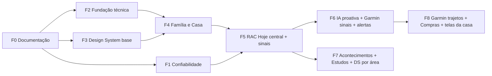

# RAC · 06 · Roadmap

Visão integrada de evolução, proposta em 13/11/2026 a partir da auditoria. É uma **proposta**: a ordem final e cada início de
fase dependem do dono. Nenhum item abaixo foi implementado, exceto a Fase 0 (esta documentação), que só conta como concluída
depois do merge. Convenções: ver o [Documento 1](01-visao-e-mapa-mestre.md#como-ler-este-conjunto).

## 1. Por que esta ordem

A orientação inicial do dono era: fundação (arquitetura e documentação) → Design System → Família e Casa → inteligência
proativa → monitoramento → Garmin → notícias → estudos → RAC Hoje → Compras. A auditoria sugere quatro ajustes:

1. **Monitor e o "requisito anterior" (notificação das 6h e atualizar ao voltar) sobem para o começo.** São prioridade alta, de
   baixo risco, sem migration, e dão confiança para o resto (saber quando algo parou antes de criar mais coisas que rodam sozinhas).
2. **Uma fundação técnica mínima vem antes da Central da Casa.** A Casa cria cerca de 7 tabelas e um módulo novo; sem a camada
   de dados, o contrato de fontes e a auditoria sem lista fixa (passos A1, A4 e A6 do [Documento 02](02-auditoria-arquitetural.md#9-plano-gradual-de-melhoria)),
   ela repetiria os problemas P-04, P-06 e P-11.
3. **Os tokens e componentes do Design System entram em paralelo com a fundação**, sem mudar o que se vê, para que as telas da
   Casa já nasçam no padrão novo (em vez de serem refeitas depois).
4. **O RAC Hoje como painel central vem antes da inteligência proativa**, porque é onde os sinais aparecem; a IA (camada 2) só
   entra quando já houver sinais determinísticos (camada 1) para interpretar.

Atalho possível: se o dono quiser **medicamentos** antes, eles podem entrar logo depois de A1 e A6, com as outras partes da
fundação em seguida.

## 2. Fases

| Fase | Conteúdo | Por que agora | Pronto quando |
|---|---|---|---|
| **F0 · Documentação** | Documento 1 (`docs/planejamento/`), mapa, regra do histórico diário | Base de todas as sessões | PR mesclado pelo dono |
| **F1 · Confiabilidade** | Monitor M1 e M2; o clique na notificação abre o destino que ela traz (qual destino é a questão D-05, em aberto); atualizar ao voltar; correção da busca (P-19); comprovar os robôs de Notícias e Vagas depois da proteção da `main`; reconciliar o estado dos documentos (conferência só leitura com o dono) | Prioridade alta, risco baixo, sem migration | Ver critérios na seção 3 |
| **F2 · Fundação técnica** | A1 camada de dados · A2 kit de UI e gráficos · A3 registro de rotas e menu · A4 contrato de fontes · A5 regras das telas para o núcleo · A6 auditoria sem lista fixa | Evita multiplicar o acoplamento com as frentes novas | Telas iguais; testes de contrato; `js/hoje.js` sem variáveis de outros módulos |
| **F3 · Design System base** | DS-0 tokens e catraca de cores · DS-1 componentes `rac-` e página interna de componentes | Telas novas nascem no padrão | Página de componentes aprovada pelo dono no celular |
| **F4 · Família e Casa** | Integrantes → medicamentos → encomendas → contas (Naturgy e outras) → condomínio. O que a casa vê é a questão D-02 e o que se guarda do condomínio é a D-13, ambas em aberto | Nova frente oficial; pedido explícito (medicamentos) | Cada parte com SQL aplicado pelo dono, backup, trava "mfa", testes e uso real |
| **F5 · RAC Hoje central** | Painel central do dono (substituir ou não o Início é a questão D-12); sinais determinísticos (etapa A, no navegador); DS-2 (menu agrupado; o tema é a questão D-01) e DS-3 (piloto no RAC Hoje e no Monitor) | Consome as fontes da Casa e do Monitor | Painel lendo só fontes; sinais com "por que estou vendo isto"; dono aprova |
| **F6 · Inteligência proativa** | Sinais no servidor (etapa B, views e pg_cron; o canal de push é a questão D-06); resumo diário; `sinais.explicar` a pedido (automático só com autorização expressa, regra vigente); Monitor M3 e M4; Garmin G1–G3 | Já há sinais para interpretar | Sinal sem repetição, com histórico e preferências; custo dentro do orçamento |
| **F7 · Contexto e progresso** | Acontecimentos; Trilhas de estudo; DS-4 (migração por área) | Evolução contextual sobre a base pronta | Acontecimento com linha do tempo e "o que mudou"; trilhas com sessões e evidências |
| **F8 · Etapas próprias** | Garmin G4–G5 (D-08 e autorização); Central de Compras (kits, patrimônio, garantias; propostas 041 e 044 na questão D-04); DS-5 (telas da casa, com autorização); divisão do núcleo (A8) | Dependem de decisões do dono | Cada uma com critério próprio, definido quando começar |

## 3. Iniciativas: classificação, benefício, risco e critério

Classificação pedida: **Funciona** (já existe e funciona) · **Parcial** (existe parcialmente) · **Corrigir** · **Refatorar** ·
**Novo** · **Agora não** (não vale a pena implementar agora).

| Iniciativa | Classificação | Benefício | Complexidade | Risco | Depende de | Prioridade | Critério objetivo de conclusão |
|---|---|---|---|---|---|---|---|
| Documentação oficial (Documento 1) | Parcial → feito nesta etapa | Alto | Baixa | Baixo | — | Alta | Documentos mesclados; teste `tests/planejamento.test.mjs` passando |
| Reconciliar estado dos documentos | Corrigir | Médio | Baixa | Baixo | Conferência só leitura pelo dono | Alta | Nenhuma divergência da lista do [Documento 07](07-decisoes-e-pendencias.md#inconsistências-de-estado-encontradas) |
| Monitor de integrações M1–M2 | Parcial | Alto | Média | Baixo | — | **Alta** | Todo processo agendado aparece com estado, última execução, sucesso, falhas e próxima prevista; teste de divergência de horários |
| Monitor M3–M4 (view e alerta) | Novo | Alto | Média | Médio (SQL) | M1, sinais | Média | Processo parado vira sinal e aparece uma vez no resumo diário |
| Clique na notificação das 6h abre o destino que ela traz | Corrigir | Alto | Baixa | Baixo | Teste no iPhone | **Alta** | Tocar no push abre a página indicada pelo aviso (hoje Agenda, Resumo ou Lista) com o app aberto, fechado e recém-atualizado (3 cenários no aparelho). Trocar o destino é a questão D-05 |
| Comprovar os robôs depois da proteção da `main` | Funciona (a comprovar) | Alto | Baixa | Baixo | Próximas execuções dos robôs | **Alta** | Um push bem-sucedido de cada robô (Notícias e Vagas) na `main` depois da criação da ruleset, registrado no histórico diário |
| Atualizar ao voltar à aba | Novo | Alto | Baixa | Baixo | — | **Alta** | Volta depois de 5 min atualiza; com campo alterado ou foco em campo, nada muda; testes do núcleo |
| Busca chama Esportes sem carregar (P-19) | Corrigir | Baixo | Baixa | Baixo | — | Média | Focar a busca sem Esportes carregado não gera erro e inclui os times |
| Camada de dados (A1) | Refatorar | Médio | Média | Médio | — | Alta | Cliente fora de `mercado.js`; login, Mercado e Lista iguais |
| Kit de UI e gráficos (A2) | Refatorar | Médio | Baixa | Baixo | — | Média | Compras não carrega Resumo, Saúde, MBA e Família |
| Registro de rotas e menu (A3) | Refatorar | Médio | Média | Médio | — | Média | Menu e rotas gerados de uma tabela; iguais para dono e casa |
| Contrato de fontes (A4) | Refatorar | Alto | Média | Médio | A1 | **Alta** | RAC Hoje sem `NLS`, `FAM`, `mbaFin`, `AGENDA_ICO`; teste de contrato por fonte |
| Regras das telas para o núcleo (A5) | Refatorar | Médio | Baixa | Baixo | — | Média | `saudeInsights` e `famMeds` no núcleo, com testes |
| Auditoria sem lista fixa (A6) | Refatorar | Alto (para F4) | Média | Médio (SQL) | — | **Alta antes de F4** | Tabela nova aparece na auditoria sem recriar `seguranca_estado()` |
| Design System DS-0/DS-1 | Parcial | Alto | Média | Baixo | — | Alta | Tokens com apelidos; catraca de cores; página de componentes |
| Tema e menu agrupado (DS-2) | Refatorar | Alto | Média | Médio | A3; tema na questão D-01 (em aberto) | Média | Dono aprova no celular |
| Integrantes (pessoas e animais) | Refatorar (`FAM` fixo) | Médio | Média | Médio | A6 | Alta (base da Casa) | Família montada pela tabela, com reserva; nada muda para a casa |
| Medicamentos | Novo | Alto | Média | Baixo | Integrantes, A6; acesso da casa na questão D-02 | **Alta** | Cadastro com foto e validade; histórico; alerta de vencimento; backup e "mfa" |
| Encomendas | Novo | Médio | Baixa | Baixo | A6 | Média | Registro, situação, retirada e histórico; bloco no RAC Hoje |
| Contas domésticas | Novo | Alto | Média | Baixo | A6 | Alta | Conta recorrente, fatura, pagamento, anexo, vencimento na Agenda, sinal de atraso |
| Condomínio (ocorrências) | Novo | Baixo | Baixa | Baixo | A6 | Baixa | Ocorrências com situação e anexos |
| RAC Hoje como painel central | Parcial | Alto | Alta | Médio | A4, F4; papel do Início na questão D-12 | Alta | Painel do dono lendo só fontes |
| Sinais etapa A (navegador) | Novo (sobre regras que já existem) | Alto | Média | Baixo | A4 | Alta | Sinais com chave, estado e "por quê"; dono adia e descarta |
| Sinais etapa B (servidor) | Novo | Alto | Alta | Médio | etapa A; canal de push na questão D-06 | Média | Sinal criado sem a tela aberta, sem repetição |
| Interpretação `sinais.explicar` | Novo | Médio | Média | Médio (custo) | Sinais; automático só com autorização expressa | Média | Explicação válida (números só dos fatos), guardada no servidor, dentro do orçamento |
| Garmin G1–G3 | Refatorar + Novo | Alto | Média | Baixo | A5 | Média | Sinais de saúde e "Recuperação da semana" sem tocar na `garmin` |
| Garmin G4–G5 (dados extras, trajetos) | Novo | Médio | Alta | Alto (privacidade) | Questão D-08 e autorização para a `garmin` | Baixa | Ativação voluntária, zonas de privacidade, retenção e "apagar tudo" funcionando |
| Acontecimentos | Parcial | Médio | Média | Baixo | — | Média | Id estável entre edições; linha do tempo; "o que mudou" |
| Trilhas de estudo | Parcial | Médio | Baixa | Baixo | — | Baixa | Trilhas, sessões e competências com evidência; bloco no RAC Hoje |
| Central de Compras (kits, patrimônio, garantias) | Funciona (base) · Agora não (evolução) | Médio | Alta | Médio | Etapa própria; questão D-04 | Baixa agora | Definido no início da etapa |
| Dividir `nucleo.js` (A8) | Refatorar | Médio | Média | Médio | A1–A4 | Baixa | Carga inicial menor, medida antes × depois |
| n8n | Agora não | — | — | — | — | — | Reavaliar nos gatilhos do [Documento 05](05-integracoes-e-automacoes.md#6-n8n-avaliar-depois-não-agora) |
| Framework, TypeScript, bundler, reescrita | Agora não | — | — | — | — | — | — |

**Fora do roadmap** (decisão do dono, 13/11/2026): a **Central Fiscal**. OCR, SEFAZ, emissão e acompanhamento fiscal não serão
desenvolvidos; o código existente continua no ar, congelado, sem evolução; a migration `040` não é pendência e não será
implementada. Registro completo no [Documento 07](07-decisoes-e-pendencias.md#decisões-tomadas).

**Proteção da `main`**: a ruleset já está ativa (13/11/2026) e não é item do roadmap; só a comprovação dos robôs está na F1.

## 3.1 Andamento da Fase 1 (13/11/2026)

Execução da Fase 1 na branch `claude/fase-1-confiabilidade-rac-dhwm7a`, no PR da Fase 1. **A Fase 1 não está concluída**: nada foi
mesclado nem publicado, e dois critérios dependem de evidência de fora (o iPhone e as próximas execuções dos robôs).

| Item | Situação | O que falta para concluir |
|---|---|---|
| Monitor M1 e M2 | **Implementado na branch**, com teste de divergência de horários ([Documento 05](05-integracoes-e-automacoes.md#43-implementação-de-m1-e-m2-fase-1-13112026)) | Merge e publicação pelo dono; conferir no celular |
| Clique na notificação abre o destino | **Implementado na branch**; testes automáticos do service worker e da página | Merge e publicação; os 3 cenários no iPhone (aberto, fechado, recém-atualizado). O destino não mudou (D-05 em aberto) |
| Atualizar ao voltar à aba | **Implementado na branch**, só para o dono; testes dos cenários pedidos | Merge e publicação; uso real. Se vale para a casa é a questão D-15 |
| Busca lateral (P-19) | **Corrigido na branch**; teste com Esportes carregado e não carregado | Merge e publicação |
| Robôs de Notícias e Vagas depois da ruleset | **Pendente**: investigação feita, sem evidência de push ainda | Um push bem-sucedido de cada robô na `main` depois da ruleset, registrado no histórico |
| Reconciliar o estado dos documentos (I-01 a I-10) | **Não iniciado** nesta execução | Conferência só leitura do dono (D-14) |

## 3.2 Andamento da Fase 2 (13/11/2026)

A Fase 1 foi encerrada para fins de planejamento pelo dono em 13/11/2026 (PR #7 mesclado na `main`, commit `95940e4`); as validações de fora
que restavam (iPhone e robôs depois da ruleset) não bloqueiam a Fase 2 e serão registradas à parte. A Fase 2 é executada na branch
`claude/fase-2-fundacao-tecnica-rnfabm`, no PR #8 para a `main`. **A Fase 2 não está concluída**: falta o merge (do dono) e a A6 depende de
SQL em produção, que só o dono aplica, com autorização própria.

| Item | Situação | O que falta para concluir |
|---|---|---|
| A1 · Camada de dados | **Implementado na branch** (`js/dados.js`), teste de cliente único | Merge e publicação; conferir login, Mercado e Lista no celular |
| A2 · Kit de UI e gráficos | **Implementado na branch** (`js/graficos.js`), teste de dependências | Merge e publicação |
| A3 · Registro de rotas e menu | **Implementado na branch** (`js/rotas.js`), teste antes × depois | Merge e publicação; conferir o menu do dono e o da casa |
| A4 · Contrato de fontes | **Implementado na branch** (Newsletter, Família, MBA e Agenda), testes de contrato | Merge e publicação |
| A5 · Regras das telas no núcleo | **Implementado na branch** (`saudeInsights`, `famMeds`, Agenda, MBA), testes de equivalência | Merge e publicação |
| A6 · Auditoria sem lista fixa | **Migration 050 preparada e testada (PGlite), não aplicada** | Merge; o dono aplicar a `supabase/050_seguranca_catalogo.sql` no SQL Editor e rodar a conferência `supabase/conferencias/050_conferir_producao.sql` (autorização própria) |

Ordem de publicação depois do merge: o site funciona com ou sem a 050 (a linha nova da Auditoria só aparece com ela), então o merge pode
vir antes; a 050 é aplicada quando o dono autorizar. Detalhes e achados no [Documento 02](02-auditoria-arquitetural.md#9-plano-gradual-de-melhoria)
e no [histórico diário](historico-diario.md).

## 3.3 Andamento da Fase 3 (13/11/2026)

A Fase 2 foi mesclada (PR #8, `1654395`; testes e Pages da `main` com sucesso em 13/11/2026). A Fase 3 é executada na branch `claude/rac-fase-3-design-system-0msm91`, no **PR #9**.
**Direção redefinida pelo dono em 13/11/2026: RAC Modern Workspace** (tema claro padrão; fundo e azul Dodger preservados; escuro funcional). A F3 passa a incluir o **piloto no RAC Hoje**
(antes DS-3) e o menu por área (antes DS-2), porque a primeira versão do DS-1 não entregava transformação perceptível. Guia: [`docs/design-system.md`](../design-system.md).
**Atualização (13/11/2026, informada pelo dono): a Fase 3 está concluída**: PR #9 mesclado na `main` (`f75a1f1`) e o piloto RAC Hoje validado no iPhone pelo dono; a direção RAC Modern Workspace está aprovada. (O texto e a tabela abaixo são o registro de como a fase foi entregue.)

| Item | Situação | O que falta para concluir |
|---|---|---|
| DS-0 · Tokens `--rac-*` e catraca de cores | **Feito na branch** (commit `385b327`) e depois **redefinido** (papel 1/2/3, tintas, degradê) em `css/rac.css` | Merge e publicação |
| DS-1 · Componentes `rac-*`, kit `js/kit.js` e página `#componentes` | **Redefinidos na branch**: cartões por função, gráficos (medidor, comparação, colunas, barras), estados, campos | Merge; o dono conferir no iPhone |
| DS-2 · Menu por área e barra inferior no celular | **Feito na branch** (só dono; casa idêntica, comprovado em 20 telas) | Merge e publicação |
| DS-3 · Piloto RAC Hoje | **Feito na branch**: painel com indicadores, gráficos, prioridades, contexto, saúde, IA e fontes recolhidas; lógica de IA intacta | Merge; uso real e aprovação do dono |
| DS-4 · Demais módulos por área | **Em andamento**: DS-4.1 Agenda feita na branch (seção 3.4); **Saúde é a próxima**; depois Finanças, Carreira e Informação | Um módulo por vez, baixando a catraca quando o CSS antigo sair de uso |
| DS-5 · Telas da casa | **Não iniciado** | **Autorização expressa do dono** |

Próximos passos técnicos: DS-4 pelo que o dono mais usa (Agenda e Saúde são os candidatos, por já alimentarem o painel); D-12 (Início × RAC Hoje); quando a Fase 4 criar medicamentos, encomendas e contas, o painel ganha esses blocos sem novo desenho.

## 3.4 Andamento da DS-4 · Agenda (13/11/2026)

A DS-4 migra os módulos para o Design System um por vez. O primeiro é a **Agenda** (DS-4.1), na branch `claude/agenda-modernizacao-ds4-xuijw0` (commit `01eee35`, **PR #10** para a `main`; **merge e publicação são do dono**).
Descrição da página, regras preservadas e testes: [`docs/agenda.md`](../agenda.md). **A DS-4.1 só conta como concluída quando o dono a vir no iPhone e o PR for mesclado.**

| Item | Situação | O que falta |
|---|---|---|
| Página Agenda no RAC Modern Workspace (abertura, indicadores, Próxima melhor ação, filtro por área, lista agrupada, 14 dias, por área, novo lembrete) | **Feita na branch**, testada (Node e Chromium em 390, 768 e 1280 px, claro e escuro) | Merge e publicação; o dono ver no iPhone |
| Regras de negócio, leitura e ações rápidas | **Preservadas**: mesmos grupos e critérios, mesma régua, mesmos caminhos de gravação (testes comparam com os de antes) | — |
| Isolamento de `js/sistema.js` | Só a tela saiu para `js/agenda.js`; Backup, Busca, Monitor, IA, Sistema e os cartões do Início ficaram intactos | — |
| Casa (Fernanda) | A página não existe para a casa; 44 telas da casa comparadas com a `main` (11 rotas × 390 e 1280 px × claro e escuro): idênticas byte a byte | — |
| Início (`#inicio`) com os cartões antigos "Próxima melhor ação" e "Agenda" | **Não migrado** (convive até a decisão D-12) | Decisão do dono (Início × RAC Hoje) |
| Catraca de cores (`LINHA_DE_BASE_CORES`, 115) | **Não baixou**: o CSS antigo da Agenda ainda serve os cartões do Início | Baixar quando o Início migrar |

**Próximo módulo da DS-4: Saúde** (não iniciado; só começa depois do pedido do dono).

## 4. Como cada fase é entregue

- Um **lote funcional** por vez: planejar, implementar, rodar o teste do módulo, rodar a suíte inteira, relatório objetivo.
- Ordem de publicação de sempre: **SQL → função → site**, cada passo só com a autorização do dono.
- Cada lote termina com o registro no [histórico diário](historico-diario.md) (o que fizemos, o que estamos fazendo, o que
  vamos fazer) e, se mudar decisão ou estado, no [Documento 07](07-decisoes-e-pendencias.md).
- Telas da casa (Fernanda) e a função `garmin` só com autorização expressa.
