# RAC · 20 · Auditoria visual, padrão de UX e validação visual (adendo ao Lote 1, 27/11/2026)

Adendo de produto do dono ao Lote 1: **qualidade visual e de experiência passa a ser critério de conclusão**, ao lado da qualidade funcional e da técnica. Este documento registra a **auditoria visual**
do que existe, os **princípios** do padrão visual do novo RAC, as **decisões** (Brainstorm e Grill Me), o que foi **implementado no Workspace**, a **validação medida** e a **lista de consolidação** do que fica para os próximos lotes.
Convenções [Fato] / [Hipótese] / [Recomendação]: ver o [Documento 1](01-visao-e-mapa-mestre.md#como-ler-este-conjunto). Decisões `N-xx`: [Registro](19-registro-de-decisoes.md#6-adendo-do-lote-1-padrão-visual-e-de-ux).

## 1. Critério permanente

Toda funcionalidade relevante só está **concluída** quando atende às três dimensões: **funcional** (faz o que a especificação pede), **técnica** (testada, segura, mantível) e **visual e de experiência** (hierarquia clara, composição coerente com o resto do RAC, estados bem
desenhados, funciona em desktop, tablet e celular, tema claro e escuro com a mesma qualidade). A validação visual (capturas, medições e correções) faz parte do relatório do lote. As referências do dono orientam **princípios de composição**, não são copiadas.
Registrado como regra permanente em `CLAUDE.md` ("Qualidade visual e UX") e no RAC Knowledge.

## 2. Auditoria do Design System e da interface [Fato, conferido no código e em capturas de tela]

As capturas abaixo foram tiradas no Chromium com dados vazios (sem login e sem rede de fora): servem para avaliar **estrutura e linguagem visual**, não o conteúdo de cada módulo.

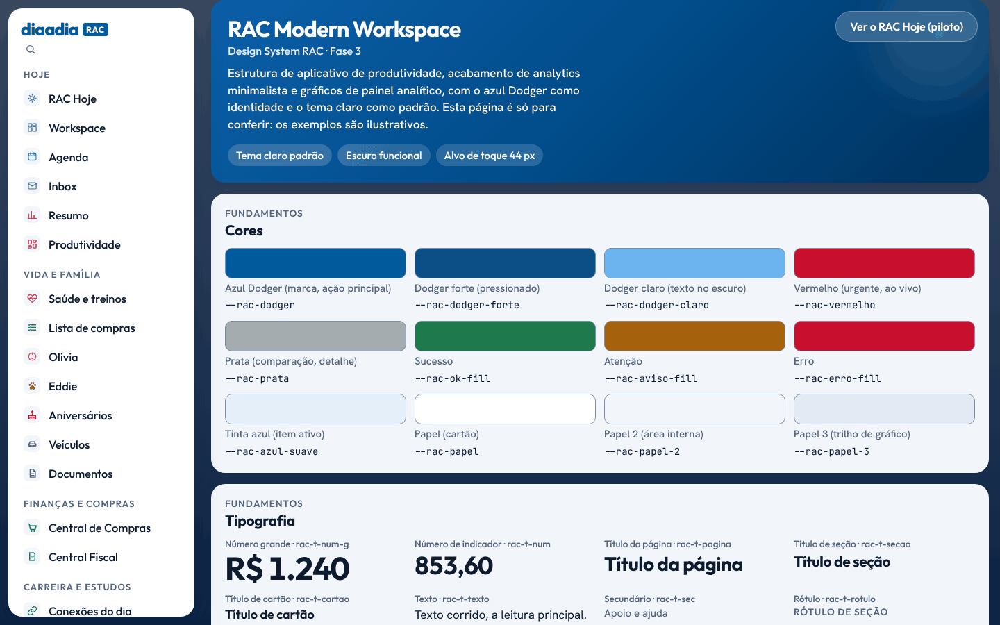
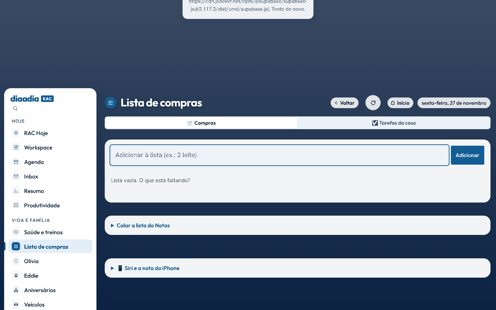
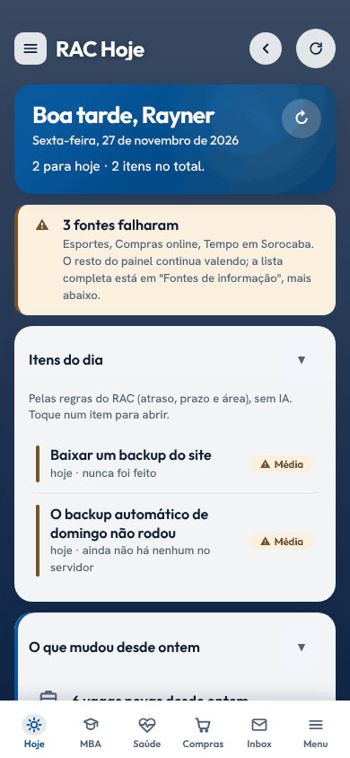

| Aspecto | Achado | Avaliação |
|---|---|---|
| **Identidade** | Tela de fundo em degradê azul-marinho, menu lateral em cartão branco, **faixa azul** (`rh-hero`) com título e resumo, cartões claros de cantos arredondados, rótulos em caixa alta, selos de estado com ícone e palavra. Tipografia com peso forte nos títulos. | Forte e reconhecível: **é a base a preservar** |
| **Tokens** | 69 tokens `--rac-*` (cores semânticas, papel, tipografia, espaçamento de 4 a 48 px, raios, sombras, camadas) com tema escuro real (`data-theme="dark"`) | Bom. Há uma **segunda cópia** de tokens antigos em `index.html` (inconsistência técnica, sem efeito visual) |
| **Componentes novos** (`rk*`, `rac-*`) | Botões (`pri`, `sec`, `ter`, `perigo`, `icone`, `fantasma`), cartão, KPI, selo, alerta, estado (carregando, vazio, erro), chip, medidor, lista | Coerentes entre si e com o tema escuro |
| **Telas no padrão novo** | RAC Hoje, Agenda, Saúde, Inbox, página de componentes | Hierarquia clara: faixa → indicadores → cartões |
| **Telas no padrão antigo** (`panel()`, `wCard()`, `ghostbtn`) | Lista, Família, Veículos, Documentos, Central de Compras (partes), Carreira | **Inconsistência principal**: botões achatados, abas de largura total, títulos de painel sem hierarquia, estados vazios só em texto, sem faixa de abertura |
| **Navegação** | Menu lateral por 6 áreas (desktop), barra inferior com 5 atalhos (celular), barra de título com voltar, atualizar, início e data | Consistente entre telas; o rótulo da área e o ícone mudam por página |
| **Cartões e painéis** | Cartão novo (`rac-card`): raio 20 px, sombra suave, cabeçalho com ação; painel antigo: mais plano, padding diferente | Dois idiomas convivendo |
| **Estados** | Padrão novo (`rkEstado`): esqueleto de carregamento, vazio e erro com ação; padrão antigo: parágrafo "Carregando…" | Parcialmente padronizado |
| **Responsivo** | Quebras em 860, 1100/1180 px, barra inferior abaixo de 861 px, alvos de 44 px (`--rac-alvo`) | Bom; sem rolagem lateral nas telas novas |
| **Tema escuro** | Tokens próprios; o padrão é o claro (por decisão da Fase 3); o escuro é "funcional" | Qualidade equivalente **nas telas novas**; telas antigas têm trechos com cor fixa |

**Conclusão da auditoria:** o RAC já tem uma linguagem visual profissional (a do RAC Hoje e do Design System), mas ela cobre **parte** do produto. O que dá a impressão de "ferramentas feitas aos poucos" é a convivência com o padrão antigo e a falta de um
**contêiner e uma linguagem de edição** para o que o usuário monta. A decisão foi **não reconstruir** o visual (N-12 mantida) e sim: (1) construir o Workspace **inteiro no padrão novo**, (2) medir o resultado e (3) listar a consolidação do resto (seção 8).

## 3. Princípios do padrão visual do novo RAC [Recomendação aprovada para os próximos lotes]

1. **Uma faixa de abertura por página** (azul do Design System): diz onde a pessoa está e oferece a ação principal.
2. **Um cartão tem uma finalidade**: título curto, conteúdo, ação; no máximo uma ação principal por cartão.
3. **Hierarquia por tamanho e peso, não por cor**: título de página > título de cartão > rótulo em caixa alta > legenda; a cor semântica (verde, âmbar, vermelho, azul) só significa estado.
4. **Espaçamento em múltiplos dos tokens** (`--rac-esp-*`); nada de margem solta.
5. **Pouco chrome**: controles de edição aparecem só no modo de edição; no modo ver, a tela é conteúdo.
6. **Todo estado tem desenho**: carregando (esqueleto), vazio (ícone, explicação e ação), parcial, erro (com "tentar de novo"), sucesso (aviso que some sozinho).
7. **Alvos de toque de 44 px e foco visível** em tudo que se toca; alternativa por teclado e por menu para qualquer gesto.
8. **Tema claro e escuro pelos mesmos tokens**: nenhuma cor escrita fora de variável (já há teste); contraste medido, não presumido.
9. **O celular é o caso principal**: o desenho nasce de 390 px e cresce; o que não cabe vai para o menu ⋯.
10. **Feedback imediato**: o que se move tem fantasma, indicador de destino e rótulo do tamanho; o que se salva diz que salvou.

## 4. Brainstorm: alternativas para a experiência de personalização

| Alternativa | Vantagens | Problemas | Decisão |
|---|---|---|---|
| A. Botões de edição fixos em cada cartão, sempre visíveis | Descobrível | Polui a tela no modo ver; conteúdo e controle misturados | Rejeitada |
| B. Botão flutuante único (FAB) com menu | Pouco chrome | Esconde as ações principais; fácil de errar no celular; conflita com a barra inferior | Rejeitada |
| C. **Barra fixa no topo só no modo personalizar** + controles contextuais só nos componentes em edição | Modo ver limpo; ações principais sempre à vista; cabe em 390 px | Ocupa altura (≈110 px no celular) | **Escolhida (N-36)** |
| D. Editor em tela cheia separado | Foco total | Perde o contexto; mais uma página para manter | Rejeitada |
| Catálogo: lista simples × **cartões com ícone, descrição, tamanho e motivo de bloqueio, em folha** | O usuário entende o que cada um faz e por que não pode | Um pouco mais alto | **Cartões em folha (N-37)** |
| Mover: só arrastar × arrastar **com fantasma e indicador** + setas + menu | Acessível; descobre pelo feedback | Mais código | **Todos (N-38)** |

## 5. Grill Me (perguntas do adendo, respondidas com evidência)

| Pergunta | Resposta | Evidência |
|---|---|---|
| A hierarquia da tela está clara? | Faixa → abas → seções (rótulo em caixa alta) → cartões; no personalizar, a barra fixa é a única coisa "de controle" no topo | capturas da seção 6 |
| Há controles demais? | Eram 7 botões iguais na barra; agora **5** (desfazer, refazer, adicionar, cancelar, concluir) e o resto (+ seção, histórico) no menu ⋯ | `tests/workspace_visual.test.mjs` mede os alvos |
| Funciona em telas pequenas? | Sim: 390 px sem rolagem lateral, barra em duas linhas, desfazer/refazer/adicionar só com ícone, catálogo em folha de baixo | `workspace_visual` em 390 px |
| Há informação redundante? | O título da página estava duas vezes; o contador de alterações some abaixo de 520 px; o tamanho é um chip `4/12`, não um texto longo | capturas |
| O modo de edição é intuitivo? | O modo é anunciado ("Personalizando" em selo âmbar), cada componente ganha alça, tamanho, menu e canto de redimensionar, e o conteúdo continua legível | capturas; `workspace_tela` |
| O usuário entende o que pode mover ou configurar? | Alça ⠿ com dica, contorno tracejado só no modo personalizar, `⋯` com o que dá para fazer, cursor de arrastar | capturas |
| O sistema dá feedback? | Fantasma e barra de destino ao arrastar; rótulo "6 de 12 colunas · altura média" ao redimensionar; aviso "Salvo" que some; erro que fica; desfazer/refazer | captura "arrastando"; testes de tela |
| A experiência é consistente com os outros módulos? | O Workspace usa só componentes do Design System (faixa, `rkBtn`, `rkSelo`, `rkEstado`, tokens, tema escuro); as telas antigas não foram tocadas | seção 2 |

## 6. O que foi feito no Workspace (antes e depois)

**Antes** (primeira versão do Lote 1, só funcional): botões brancos soltos em várias linhas, abas improvisadas, conteúdo esmaecido na edição, catálogo em lista apertada, avisos que empurravam a página.

**Depois:**

| Modo | Computador | Tablet | Celular |
|---|---|---|---|
| Ver, claro | 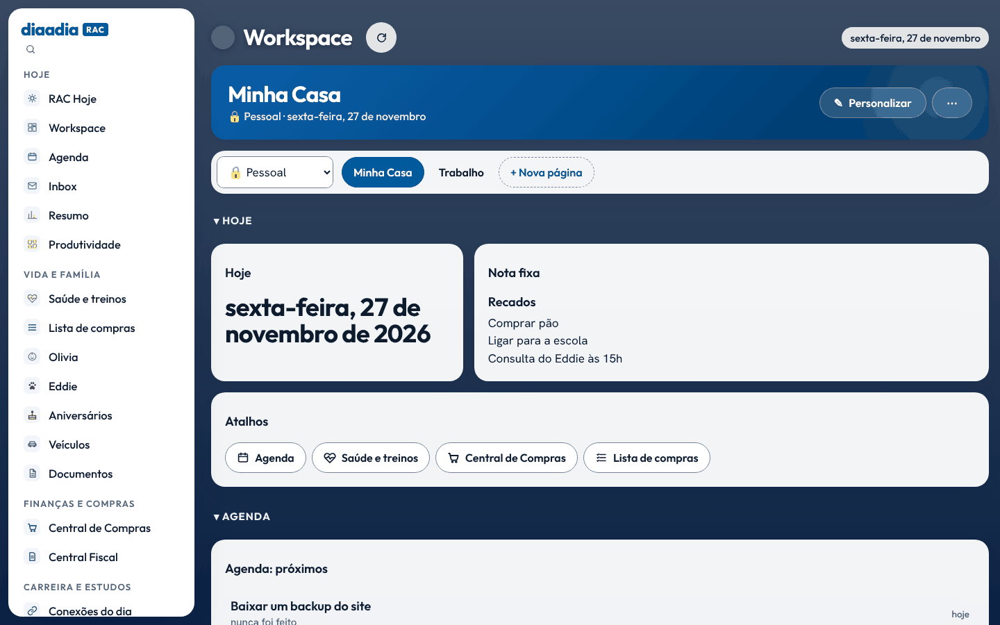 | 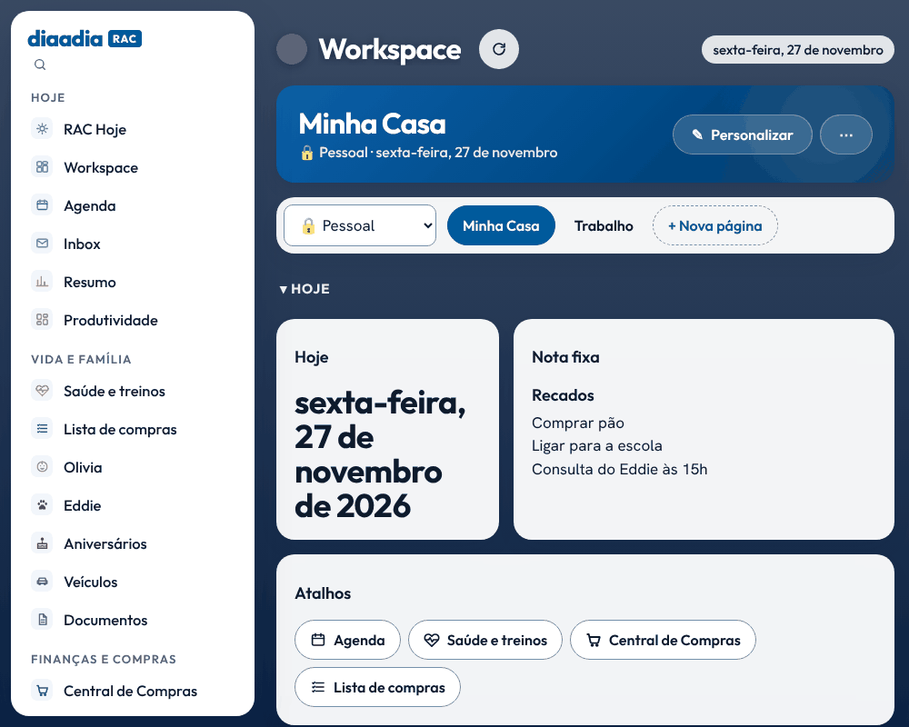 | 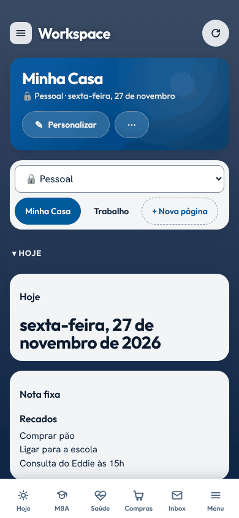 |
| Ver, escuro |  | |  |
| Personalizar, claro |  | | 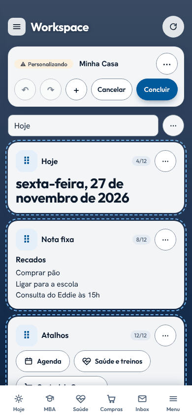 |
| Personalizar, escuro |  | 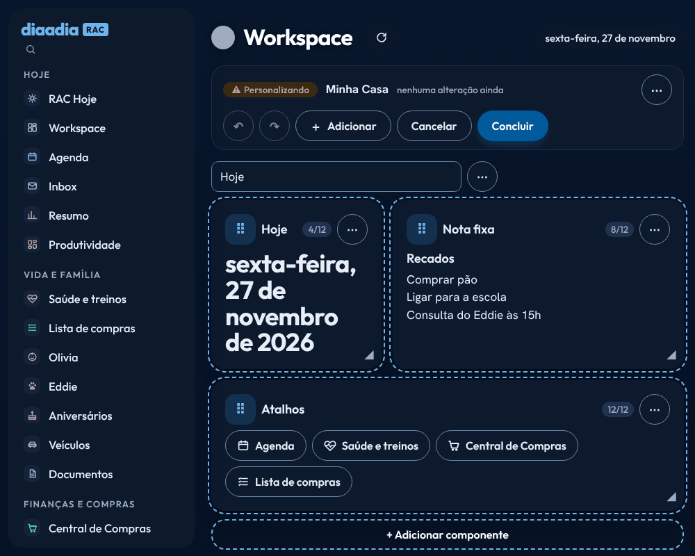 | 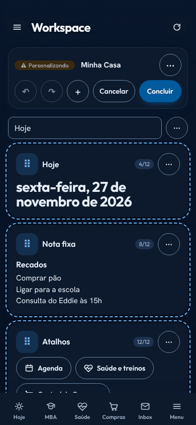 |

Catálogo, arrastar, menu de um componente e estado vazio:

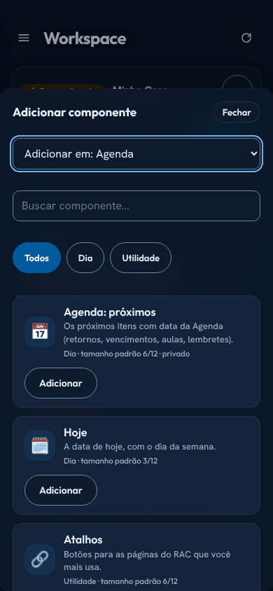
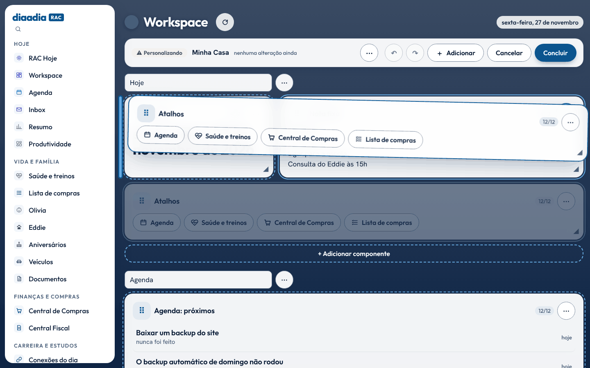

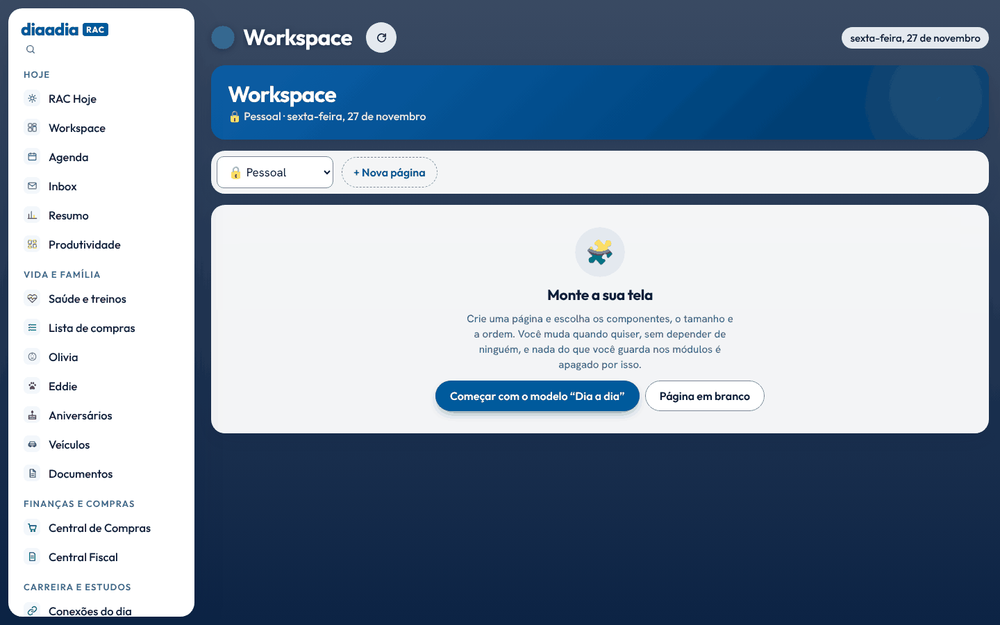

Mudanças principais: faixa azul do Design System com o nome da página e "Personalizar"; abas das páginas num contêiner branco (aba ativa em azul); **barra fixa** só no modo personalizar; chrome por componente (alça, chip `n/12`, `⋯`, canto de redimensionar) com contorno
tracejado azul claro só na edição; fantasma, indicador de destino e rótulo de tamanho; catálogo em cartões com ícone, categoria em chips, busca, seção de destino e motivo de bloqueio; toast fixo para avisos; estados vazios com ícone; selos para oculto e desativado; botões
e campos do Design System (`rac-btn`, `rac-campo-entrada`).

## 7. Validação visual medida [Fato]

`tests/workspace_visual.test.mjs` (Chromium; 6 casos = 3 larguras × 2 temas, cada um em ver, personalizar e catálogo) mede: ausência de rolagem lateral; nenhum componente sobrepõe outro; alvos de toque ≥ 44 px (barra, abas, alças, menus, catálogo);
a barra de personalizar não cobre o começo do conteúdo, cabe na largura e **continua fixa no topo ao rolar**; contraste do texto (WCAG 2.1, 4,5:1 e 3:1 para texto grande) de abas, títulos, notas, atalhos, selos, botões e cartões do catálogo, nos dois temas; o conteúdo permanece com opacidade 1 na edição.
Mais `tests/workspace_tela.test.mjs` (comportamento) e `tests/design_system.test.mjs` (nenhuma cor escrita fora de variável).

**Problemas que a validação achou e foram corrigidos neste lote:**

| Problema | Onde apareceu | Correção |
|---|---|---|
| Botão `⋯` da seção com 33 px de altura (abaixo de 44 px) | medição de alvos | botão do Design System (`rac-btn--icone`) |
| Barra de personalizar **não ficava fixa** ao rolar (o pai era do tamanho da barra) | medição de rolagem em tablet e celular | o contêiner passa a `display:contents` no modo personalizar |
| Catálogo com texto espremido em colunas de 70 px | captura do catálogo | uma coluna, cartão com ícone, texto e botão que quebra de linha |
| Widget com configuração incompleta quebrava ("Invalid time value") | captura da Agenda | todo widget recebe a configuração normalizada com os padrões |
| Nome da página truncado ("Min…") e `⋯` esticado no celular | captura do celular | `⋯` no cabeçalho da barra com tamanho fixo; contador oculto abaixo de 520 px |
| Barra de edição com 7 controles do mesmo peso | revisão da hierarquia | 5 controles; Concluir em destaque; o resto no menu |
| Data em caixa alta pelo `capitalize` ("Sexta-Feira, 27 De…") | captura | removido |
| Aviso inline empurrava o conteúdo | revisão | toast fixo (sucesso some, erro fica) |
| Captura "ver" mostrando a tela de login por trás | captura | só do ambiente de teste (o portão de entrada ficava visível): corrigido na montagem do teste |

## 8. Consolidação visual: o que fica para os próximos lotes [Recomendação, não executada]

| Item | Evidência | Lote sugerido |
|---|---|---|
| Migrar as telas no padrão antigo (`panel()`, `wCard()`, `ghostbtn`) para `rkCard`, `rkBtn` e `rkEstado`, uma tela por vez, com comparação antes × depois | seção 2 | contínuo, junto de cada módulo (a Lista e a Família primeiro) |
| Unificar as duas cópias de tokens (`index.html` e `css/rac.css`) | seção 2 | Lote 2 (limpeza oportuna) |
| Janelas e menus: o Workspace tem folha e menu próprios; trocar pelo componente comum quando existir no kit | `js/workspace.js` (`wkFolha`, `wkMenu`) | Lote 2: extrair para `js/kit.js` |
| Abas: o estilo das abas de página é novo; padronizar com as abas da Lista, Esportes e Saúde | seção 2 | Lote 2 |
| Barra inferior do celular com os cinco ambientes e o botão central de Captura | [Documento 13](13-visao-e-arquitetura-do-novo-rac.md) (N-24) | Lote 2, com protótipo e aprovação do dono |
| Pré-visualização real do widget no catálogo (hoje: ícone, descrição e tamanho) | seção 6 | Lote 2, quando houver widgets dos módulos |
| Gráficos e tabelas: auditar o kit de gráficos com o mesmo método (contraste, alvos, tema escuro) | `js/graficos.js` | Lote 2 (widgets de gráfico) |
| Teste de captura de tela com comparação por pixels para as telas migradas | seção 7 | quando a primeira tela antiga for migrada |

## 9. Limites desta validação

As capturas usam um banco simulado e dados de exemplo; o contraste foi medido por cálculo (não por simulação de daltonismo); o toque longo para arrastar no iPhone **não foi validado em aparelho real** (a alternativa por menu e setas existe e está testada);
a faixa azul em degradê foi conferida por texto branco sobre azul escuro e por inspeção, não por amostragem de pixels. A validação do dono no iPhone e no computador continua sendo o critério final.

## 10. Lote 2: Minha Casa (27/11/2026)

**Método:** `tests/workspace_casa_visual.test.mjs` (Chromium, 3 larguras × 2 temas): primeira utilização, página "Casa completa" no modo ver, modo Personalizar e catálogo, com as medições do Lote 1 (rolagem lateral, sobreposição, alvos de 44 px, contraste WCAG, barra fixa) e mais **texto cortado** nos cartões e a **barra do celular** (7 itens). Capturas feitas com dados simulados (`RAC_CAPTURAS=1`), olhadas uma a uma. **Isto é validação em navegador automatizado; não houve teste em iPhone real.**

**Capturas** (`docs/planejamento/img/`): `lote2-primeira-vez-claro-1440.png`, `lote2-primeira-vez-claro-390.png`, `lote2-primeira-vez-escuro-1000.png`, `lote2-casa-completa-claro-1440.png`, `lote2-casa-completa-claro-1000.png`, `lote2-casa-completa-claro-390.png`, `lote2-casa-completa-escuro-1440.png`, `lote2-casa-completa-escuro-1000.png`, `lote2-casa-completa-escuro-390.png`, `lote2-personalizando-claro-1440.png`, `lote2-personalizando-escuro-390.png`, `lote2-catalogo-claro-390.png`, `lote2-barra-celular-claro-390.png`.

**Decisões visuais:** a vista normal só mostra a faixa azul (nome da página, saudação, data, "Personalizar" e "⋯"), os rótulos de seção e os cartões; resumo do dia em largura total com um indicador em destaque (azul) e três secundários; pares de cartões por seção; listas com alvo de 44 px; gráficos com valor e rótulo em cada barra (`racDica`); estados vazios com texto próprio; o mesmo kit (`rkCard`, `rkKpi`, `rkLista`, `rkEstado`) nos três módulos, sem estilo por widget (só o grid `.wm-kpis`).

**O que a medição e a olhada acharam, e foi corrigido:**
1. Boas-vindas com título e texto soltos sobre a foto de fundo: contraste 1,09 no tema claro. Passou para dentro de um cartão (regra: texto novo nunca solto sobre a foto).
2. Barra de seletor de espaço aparecendo na primeira tela e na vista de uma página só: ruído sem função. O seletor passou a existir só em espaço compartilhado; no pessoal a troca fica no menu ⋯ e, sem página, em botões discretos.
3. Três modelos em 2 colunas deixavam um cartão órfão: grade com colunas de 200 px (3 colunas no computador, 1 no celular).
4. O aviso "Sua casa está pronta" ficava espremido no celular (`left:50%` limitava a largura a metade da tela): largura por conteúdo.
5. No celular, o chip de tamanho (`6/12`) cortava o título do cartão no modo Personalizar; como a grade é de 1 coluna, o chip some abaixo de 861 px.
6. A busca do catálogo não achava "saude" (sem acento) e, dependendo do caso, nem "saúde": passou a ignorar acento e maiúscula.

**Barra do celular:** com a Casa na frente, 7 itens em 390 px (55 px cada), rótulos sem corte e alvos de 44 px, medidos. **Pendente para o dono (iPhone):** aprovar a Casa na barra, toque longo para arrastar, e a leitura dos cartões ao ar livre.

**Limites:** dados simulados (o dono verá os dele); gráfico de 12 meses com poucos dados parece vazio, o que é o dado; o contraste sobre degradê (faixa azul e indicador em destaque) foi conferido visualmente, não por número.

## 11. Lote 3: Timeline, Busca global e widget (27/11/2026)

**Método:** `tests/timeline_visual.test.mjs` (Chromium, 3 larguras × 2 temas): Timeline (normal, filtros abertos, agrupada por categoria, resultado parcial), Busca (inicial, com resultados, sem resultado) e o widget na Minha Casa. Medições: rolagem lateral, sobreposição entre eventos e resultados, alvos de 44 px (chips, selects, botões, cada linha), contraste WCAG e texto cortado. Capturas olhadas uma a uma. **Navegador automatizado com dados simulados; não houve teste em iPhone real.**

**Capturas** (`docs/planejamento/img/lote3-*`): `timeline-{claro,escuro}-{1440,1000,390}`, `timeline-filtros-*-390`, `timeline-parcial-*-390`, `busca-inicial-*`, `busca-resultados-*`, `busca-vazia-*-390`, `widget-claro-1440`, `widget-escuro-390`.

**Decisões visuais:** linha do tempo com coluna de hora, marcador circular com a cor e o ícone da categoria (tracejado quando é agendado), título, resumo e origem; evento de dia inteiro não repete "dia todo" sob o cabeçalho do dia; "Agendado" em cartão recolhível; busca em cartão com o campo grande, filtros discretos (Tudo, Pessoal, Casa e origem) e resultados agrupados por origem (a origem é o título do grupo e não se repete em cada linha); estados inicial, carregando, vazio, curto, parcial e erro com texto próprio; tudo com o kit (`rkCard`, `rkEstado`, `rkAlerta`, `rkSelo`, `rkBtn`) e tokens, sem cor escrita.

**Achados corrigidos nesta rodada:** (1) a página `#busca` antiga nunca aparecia (o campo lateral e a `<section>` tinham o mesmo `id`; o roteador mostrava o campo); (2) "dia todo" repetido em dezenas de linhas; (3) "agendado" repetido na meta e no selo; (4) origem repetida em cada resultado já agrupado; (5) ícone de busca aparecendo dentro da própria tela de busca; (6) estado de erro total aparecia junto com um aviso parcial redundante.

**Cabeçalho do celular:** o ícone de busca (44 px) entrou ao lado de Voltar e ↻; para o título continuar inteiro a 375 px (teste da Newsletter, Olivia e Segurança) o botão Início sai do cabeçalho do celular do dono, porque a barra inferior já traz a Casa, e a distância entre os itens diminui a 480 px ou menos. A barra inferior não mudou.

**Limites:** gráficos não se aplicam; o contraste sobre a faixa azul (degradê) foi conferido visualmente; a lista longa de eventos idênticos das capturas é dado de teste.
